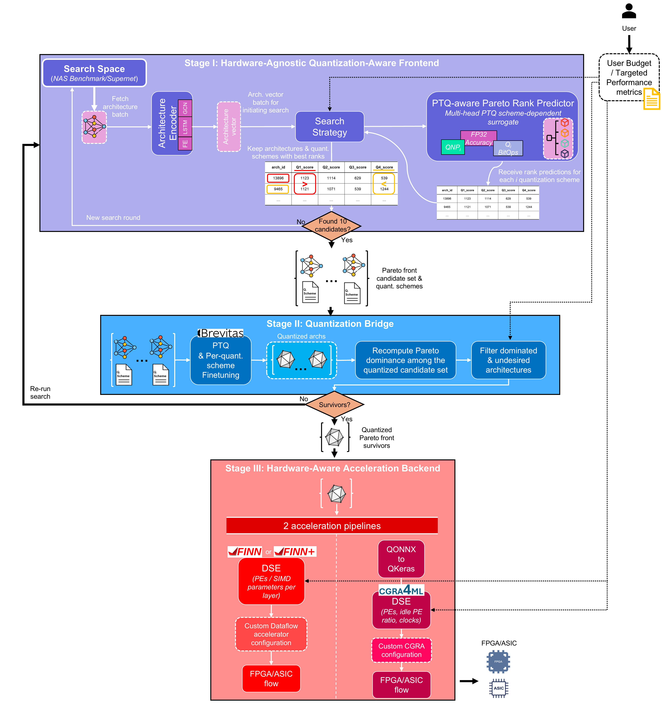

# PTQ-NAS-Bench: A Multi-Scheme Post-Training Quantization Benchmark for Hardware-Efficient Architecture and Scheme Co-Search

-blue.svg)
-blue.svg)


## 📖 Abstract

## Abstract

This paper presents **PTQ-NAS-Bench**, a multi-scheme Post-Training Quantization (PTQ) extension of the NAS-Bench-201 Neural Architecture Search (NAS) benchmark, and **PTQ-CoNAQ**, a reference BitOps-constrained architecture-scheme search pipeline with downstream hardware mapping.

**PTQ-NAS-Bench** releases ground-truth quantized accuracy—both after PTQ and two epochs of fine-tuning—for up to **15,625 CIFAR-10 architectures** under four PTQ schemes with 8-bit and sub-8-bit weights and activations, obtained through a 324-configuration PTQ sweep.

**PTQ-CoNAQ** scores candidates with a zero-cost PTQ sensitivity metric, ranks them per scheme, and exports the top ten candidates across schemes based on a hardware cost budget for mapping to edge accelerators. Our reference metric, the **Quantization Noise Proxy (QNP)**, attains Spearman correlations of **−0.69, −0.71, and −0.43** over all measured architectures against measured accuracy at 8-bit, 4-bit, and 2-bit-weight schemes, respectively. Meanwhile, our scheme-selection policy achieves a mean accuracy regret of **2.44 points** against an oracle at **0.25 GBitOps**, compared to 4.98 for random selection.

Overall, the results reveal that QNP does not improve upon FP32 accuracy and BitOps, while a *most-expensive-feasible* scheme policy performs better at every budget. Together, these contributions establish a reproducible foundation for hardware-aware NAS under realistic deployment precision.

<p align="center">
  
  <br>
  <em>Figure 1: Overview of the PTQ-CoNAQ.</em>
</p>

---

## 🌟 Key Features

*   **Comprehensive PTQ Benchmark:** Ground-truth quantized accuracy for all 15,625 NAS-Bench-201 architectures on CIFAR-10.
*   **Multiple Quantization Schemes:** Extensive evaluation across four diverse bitwidth schemes: Q1 (8W8A), Q2 (4W4A), Q3 (2W8A), and Q4 (2W2A).
*   **PTQ Sensitivity Metric:** Introduction and implementation of the **Quantization Noise Proxy (QNP)**.
*   **Multi-Head Pareto Rank Predictor:** A ListMLE-trained Multi-Layer Perceptron (MLP) evaluated via 10-Fold Cross Validation, utilizing Latin Hypercube Sampling (LHS) for robust training data selection.
*   **Hardware-Aware Co-Search:** Integrated Multi-Objective Evolutionary Algorithm (MOEA) and Random Search (RS) pipelines to find optimal architecture-scheme pairs.

## 📂 Repository Structure

The repository is organized into two main components: the generation of the benchmark and the search pipeline.

```text
PTQ_NAS_BENCH_GitHub/
├── Benchmark_scripts/      # Scripts for generating the PTQ-NAS-Bench dataset (NATS-Bench extraction, PTQ & Fine-tuning)
├── Figures                 # Final plots generated from the visualization scripts
├── PTQ_Conaq/              # The core PTQ-CoNAQ search pipeline
│   ├── data_processing/    # Feature extraction, QNP calculation, and dataset merging
│   ├── models/             # Pareto Rank Predictor (ListMLE MLP) training and evaluation
│   ├── search_strategies/  # Random Search and MOEA implementations
│   ├── utils/              # Helper scripts (LHS sampling, PTQ configurations, Pareto ranking)
│   └── visualization/      # Plotting scripts (Accuracy Drop, Pareto Fronts, Correlations)
├── Execution_RunBook.txt   # Step-by-step terminal commands to reproduce the entire project
└── README.md               # This document
```
---

## ⚙️ Installation & Setup

Τhis project utilizes two separate Python environments. We highly recommend using [Conda] to manage them.

### 1. External Datasets & Dependencies
Before running the benchmark scripts, ensure you have installed and downloaded the following necessary assets:
*   **NATS-Bench API:** You must install the official NATS-Bench repository to access the architecture topologies. Follow the instructions here: [https://github.com/D-X-Y/NATS-Bench](https://github.com/D-X-Y/NATS-Bench).
*   **NATS-Bench Weights:** Download the full weights (`NATS-tss-v1_0-3ffb9-full.tara*`) from the official NATS-Bench repository.
*   **CIFAR-10 Dataset:** Download the Python version of CIFAR-10 batches.
*   **Naszilla Repository:** Certain data processing scripts require the Naszilla framework. You must clone their repository into your workspace from here: [https://github.com/naszilla/naszilla](https://github.com/naszilla/naszilla).
*   *Note:* Update the base paths in `Execution_RunBook.txt` to point to your local download directories.

### 2. PTQ Benchmark Generation Environment (Python 3.10.19)
This environment is used for running the scripts inside the `Benchmark_scripts/` folder. It handles the extraction of the NATS-Bench weights and the quantization-aware fine-tuning.
To set up the environment for the benchmark generation, you need to install the necessary libraries required to run all the scripts. Please follow this instruction:

```bash
pip install -r requirements_bench.txt
```
### 📥 Pre-computed Benchmark Dataset (Zenodo)

Generating the benchmark from scratch is a highly time-consuming process. Therefore, we have pre-computed the entire benchmark. You can download the complete, ready-to-use dataset—which is required for the PTQ-CoNAQ pipeline, but can also be used for independent exploration with different approaches—directly from Zenodo:

[](https://zenodo.org/records/21852794)

**Download Link:** [PTQ-NAS-Bench Dataset on Zenodo](https://zenodo.org/records/21852794)

### 3. Predictors & Co-Search Environment (Python 3.7.16)

This environment is strictly used for all scripts inside the `PTQ_Conaq/` folder. It handles data processing, encoding, predictor training (MLP), evolutionary search algorithms, and visualization.
To set up the environment for the PTQ-CoNAQ search pipeline, encoder, and predictors, you need to install the necessary libraries required to run the corresponding scripts and verify that the Zenodo dataset is correctly placed in your workspace. Please follow this instruction:

```bash
pip install -r requirements_conaq.txt
```
---

## 🚀 How to Run (Quick Start)

We have provided a comprehensive, step-by-step guide in the **`Execution_RunBook.txt`** file located in the root directory. It contains the exact terminal commands required to reproduce the entire project.

The overall pipeline operates in the following sequence:
1. **Benchmark Generation:** Extracting weights and executing PTQ & Fine-tuning for all architectures.
2. **Data Processing:** Calculating QNP, BitOps, and Proxy Features.
3. **Utilities:** Applying Latin Hypercube Sampling (LHS) and Global Pareto Ranking.
4. **Architecture Encoding:** Generating FE cache, training the GCN-LSTM encoder, and exporting the pre-computed embeddings.
5. **Models:** Training the Multi-Head Pareto Rank Predictor (ListMLE).
6. **Search Strategies:** Running the hardware-aware Co-Search (MOEA / RS).
7. **Visualization:** Generating the plots and boxplots used in the paper.

---
